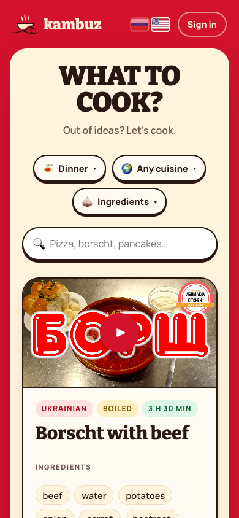
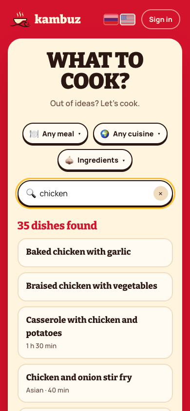
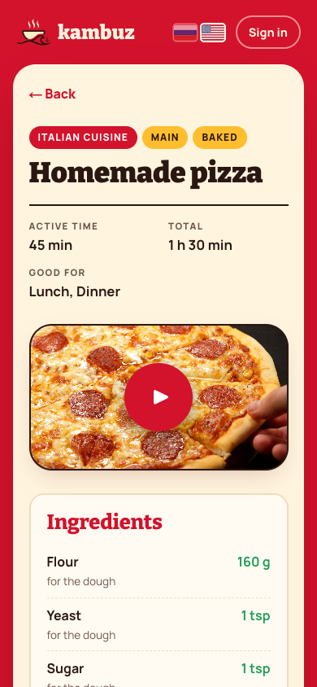

# Kambuz

Multi-agent Claude pipeline that turns YouTube cooking videos into grounded, structured
recipes, and the "What to cook?" site that serves them in Russian and English. Give it a
video or playlist URL; it writes one recipe per dish into MongoDB, and the site in `web/`
picks you a dish by meal, cuisine and the ingredients you have.

**Live:** https://kambuz-lilac.vercel.app (English: https://kambuz-lilac.vercel.app/en)

Kambuz (камбуз) is the galley on a ship. The first source channel is a ship's cook
who films his recipes in Russian, without descriptions or chapters, so the only
input is the auto-generated captions. One video often holds five to eight dishes.

## Features

- **One recipe per dish** — a scout splits a vlog into the dishes actually cooked and
  skips videos that aren't recipes; each step links to its moment in the video
- **Grounded, not invented** — a verifier checks every ingredient and amount against
  the transcript, and every quantity says whether it was stated, inferred or unknown
- **Duplicates caught** — a judge compares a new dish with similar ones and keeps the
  more complete version
- **Russian and English** — Sonnet 5.5 translates each recipe, code checks and an
  Opus 5.5 proofread decide whether the translation is good enough to show
- **Search** — by dish or ingredient, in Russian or English, within the meal, cuisine
  and ingredient menus
- **Add a video from the site** — admins (Google sign-in) paste a link; a worker on
  your own machine picks up the job and the recipes appear a few minutes later
- **Measured** — an eval for the extraction, a bench for comparing models per agent,
  a translation eval, and the cost of every run in dollars

  
  
  

## Stack

TypeScript · Claude API (Haiku 5.5, Sonnet 5.5, Opus 5.5) with Zod structured outputs ·
yt-dlp · MongoDB Atlas · Next.js 16 (App Router, Cache Components) · Auth.js · Vercel ·
vitest

## Sources

Videos in any language work. The recipes are written in Russian, then translated into
English. For each video the fetcher reads the info json and keeps the best timed text it has:
the auto-captions of the original speech (`<lang>-orig`), else subtitles the author
uploaded, else (a silent video) its chapter titles. The author's description goes
to every agent as a second source, so ingredients and amounts written there count
as stated, and a video with nothing but a description still yields a recipe.

## How it works

Seven stages run per video. Every LLM stage is a pure function with a typed
(Zod) structured output, and the orchestrator in plain TypeScript does all the I/O.

| Stage | What it does | LLM |
|---|---|---|
| fetcher | `yt-dlp` pulls metadata and the best caption track (see above), parsed into timestamped cues | no |
| scout | splits the transcript into one segment per dish actually made; says when a video is not a recipe at all (a vlog, tips and hacks, a knife lesson, a review) | yes |
| extractor | one call per segment: name, ingredients with quantities, ordered steps | yes |
| verifier | checks every ingredient and step against the raw transcript and quotes the evidence | yes |
| categorizer | cuisine, meal type, course, cooking method, timing, and a `dishKey` slug used for duplicate detection | yes |
| judge | finds candidate duplicates in the catalog, scores completeness, decides same dish or variant | yes |
| translator + proofreader | Sonnet 5.5 writes the English version of the steps and ingredients; code checks and an Opus 5.5 proofread decide whether it is stored | yes |

Nothing is invented. Every ingredient and step must be supported by what the
chef said. Quantities carry a provenance tag: `stated` (he said "1.5 litres"),
`inferred` (he said "take an onion", so one onion), or `unknown`. Ingredients
that are not in the controlled vocabulary in `vocab/` are reported as unmapped,
never made up; the vocabulary files are edited by hand only.

Each ingredient has two notes: `note`, shown to the cook ("нарезать соломкой",
"для соуса", "или 6 г сухих дрожжей"), and `sourceNote`, never shown: where the
information came from ("в описании 6, в видео 8", "количество не названо", which
clue decided butter or oil).

A typical video costs about 2 cents through categorizing, on Haiku 5.5; translating
and proofreading add about 4 cents per recipe.

Per-video stage results are cached in `.cache/<videoId>/`, so a run resumes
where it stopped and a single stage can be re-run after a prompt or vocabulary
change. Every LLM call logs token usage, and the run report prints the total.
Re-processing a segment (same video and segment start) always replaces its
previous catalog entry outright, even with a lower score — the judge and
completeness comparison only run across different segments.

## Setup

    brew install yt-dlp        # or: pipx install yt-dlp
    npm install
    cp .env.example .env       # add ANTHROPIC_API_KEY and MONGODB_URI (see below)

Node 22 or newer.

## Run

    npm run kambuz -- ingest "https://youtu.be/bskR7LVpF7I"
    npm run kambuz -- ingest "https://www.youtube.com/playlist?list=..."
    npm run kambuz -- ingest <url> --only-stage extract   # rerun extraction after editing vocab
    npm run kambuz -- translate --yes                    # English for recipes that have none
    npm run eval                                         # score the catalog against eval/cases

`--only-stage <stage>` re-runs that stage and every stage downstream of it
(`scout` < `extract` < `verify` < `categorize` < `translate`); `--force` alone re-runs
every agent stage. Neither flag re-fetches captions — the `yt-dlp` source
stage is only re-run when its cache entry is missing.

While it runs, `ingest` draws a live tree with one line per video (spinner
while it's in progress) and, under it, one line per stage — a segment's
working name in brackets where more than one is running at once, "cached"
for a stage served from `.cache/`, or elapsed time and a token count once
it's done. A video's stage breakdown and its `N recipes · Xs · Yk tokens`
summary stay on screen after it finishes rather than disappearing, and
errors are shown in red. If two calls for the same agent overlap closely
enough that a token count can't be attributed with confidence, that stage
shows `— tok` instead of guessing. Pass `--quiet` to skip the tree and just
print the final report.

Each run writes a report to `reports/<timestamp>.md` and prints its path
and the token-usage table to stdout. The report lists what was written,
what the verifier flagged, which segments failed, every ingredient the
extractor could not map to `vocab/ingredients.json`, and the recipes whose
translation was not accepted.

## Reports

Every LLM call is priced from `src/llm/pricing.ts` (per-model $/1M tokens,
cache reads at 0.1x and cache writes at 1.25x the input rate) and the
markdown report's token table gains a `$` column and a `Cost:` line.

Each run also writes `reports/<timestamp>.html` — one self-contained page,
no external requests, light/dark via `prefers-color-scheme` — with cost and
token tiles, a per-agent cost table, the video and catalog-change tables,
and a card per recipe written this run: ingredients with their vocab id (or
"unmapped") and provenance, and steps whose timestamps link straight to
that point in the source video. Pass `--open` to open it automatically
(`open` on macOS, `xdg-open` elsewhere) once the run finishes.

Every run also appends one line to `reports/spend.jsonl` (timestamp,
source, cost, tokens), and the HTML header shows the running total spent
across every past run.

The cache is keyed by video and stage, so nothing short of deleting a file
re-fetches captions. To start a video over completely — a corrupt download,
a changed caption track — remove its directory:

    rm -rf .cache/<videoId>

A cache file that is corrupt or no longer matches its schema is ignored with
a warning and the stage re-runs, so a half-written file cannot wedge a video.

## Eval

    npm run eval              # scores the existing catalog against eval/cases/*.json
    npm run eval -- --ingest  # ingests each case's video first (real API calls if uncached)

Each case names a video and what the pipeline should find in it (dish count,
names, cuisines, meal types, and optionally specific ingredients with their
provenance). The command prints a table and exits non-zero if any check fails,
so a prompt or vocabulary change can be regression-tested. Without `--ingest`
it never calls the API — it only reads what is already in the database.

## Translation

Every kept recipe gets an English version (`en` on the recipe document) written
by the translator (Sonnet 5.5) and checked twice: by code (same number of steps
and ingredients, every number kept, temperatures in °C, no Cyrillic left) and by
the proofreader (Opus 5.5, against the Russian only). Problems are handed back
to the translator once; a translation that still has problems is not stored,
the recipe stays Russian-only, and the run report lists it under "Not
translated". A translation failure never costs the recipe itself.

    npm run kambuz -- translate                 # how many recipes have no English, and the cost
    npm run kambuz -- translate --yes [--limit N]
    npm run kambuz -- translate --yes --redo    # translate every recipe again (after a prompt change)
    npm run kambuz -- eval-translation [--yes]  # score the translator on eval/translation.json

The translator writes the dish name (sentence case, "Guacamole with shrimp"), the
steps and each ingredient's plain name, the one the Russian page shows
(`baseName`), with its cook-facing note; the amount is a separate column on both
pages. The prompt carries a short glossary of Russian cooking words that models
get wrong (зажарка, маслины, разбить яйца, почти до полуготовности…).

When the chef spoke English (English captions or subtitles in the cached
source), the translator also gets his transcript for that dish and uses his own
words, so an English video isn't translated into Russian and back. The Russian
recipe still decides what is in it, step for step.

When the proofreader names the lines it objects to, only those lines are
rewritten and re-checked, not the whole recipe. Its findings are stored with the
translation (`en.review`), so its strictness can be reviewed later.

Haiku 5.5 was not good enough here: on the 20 recipes in `eval/translation.json`
it left Russian in the output and changed meanings, where Sonnet 5.5 got 18 of
20 with no issues. To try another model, run the eval with
`KAMBUZ_MODEL_TRANSLATOR=<model>`; it never writes to the catalog.

## Bench

Compares models and thinking effort for one agent on the same cached inputs
(`.cache/<videoId>/scout.json` segments and their `extract-<i>.json` drafts),
without touching the catalog:

    npm run kambuz -- bench categorizer --models claude-sonnet-5,claude-sonnet-5:low,claude-haiku-4-5
    npm run kambuz -- bench verifier --models claude-sonnet-5,claude-sonnet-5:low --repeat 2 --yes --open

Each variant is `model[:effort]` (`low`, `medium`, `high`, `xhigh`, `max`). Without `--yes` the
command only prints the plan ("N calls across M variants on K segments") and
calls nothing; with it, it writes `reports/bench-<agent>-<timestamp>.json` and
`.html` and prints a table per variant with scores, tokens, cost and latency.

- `categorizer` scores cuisine, course, method and meal types against hand labels in
  `eval/bench/categorizer.json` (format in `eval/bench/README.md`), plus dishKey
  stability across `--repeat` runs.
- `verifier` needs no labels: it plants errors into each cached draft (an
  ingredient borrowed from a similar dish, a quantity ×1.5, a swapped unit, a
  changed number in a step, an invented step). A planted item counts as
  detected only when the verifier explicitly marks it unsupported; an omitted
  entry is reported separately. Detection is shown next to the false-positive
  rate on the untouched drafts.

The JSON keeps every case's exact input draft, raw model output and token
usage, plus hashes of the prompt and vocabulary, so a saved run can be
re-scored after a scoring change without calling the API:

    npm run kambuz -- bench rescore reports/bench-verifier-<timestamp>.json

Every rate counts failed calls as misses and shows hits/total with a 95%
Wilson interval; with a dozen segments those intervals are wide, so use
`--repeat 3` or more before choosing a model.

The plan also prints a rough dollar estimate per variant (prompt characters / 3
for input, a fixed per-call output guess that adaptive thinking can exceed).
A variant written without an effort on a model that thinks by default is
labelled with that default, e.g. `claude-sonnet-5 (default effort: high)`. A
cost shown as `≥$…` is a lower bound: some attempts failed to parse and their
usage could not be recorded.

A variant the API rejects (for example an effort on a model without it) is
recorded as errors in the report; the rest of the bench still runs.

**The categorizer bench's method labels are incomplete.** When `category` was
split into `course` and `method`, only the old bake/stew/grill categories named a
method, so 12 of the 23 rows in `eval/bench/categorizer.json` still have
`method: null`. Re-watch those segments and fill in a real method before the
method rate is worth reading; until then it measures "did the model also guess
null", not "did it get the method right".

## Database and website

The catalog lives in MongoDB (a free Atlas M0 cluster is plenty), and `ingest`,
`eval` and `worker` need its connection string in `.env`:

    MONGODB_URI=mongodb+srv://<user>:<password>@<cluster>.mongodb.net/kambuz

Collections: `recipes` (live ones, plus each replaced version with
`archived: true`; the English version is the `en` field), `videos` (every video
the pipeline has seen and what came of it), `jobs` (add-video requests from the
site), `workers` (the worker's heartbeat, shown on the admin page) and `vocab`
(copied from `vocab/*.json` whenever the worker starts).

The catalog used to be JSON files in `catalog/`; that folder is in git history.
To load such a folder back into the database:

    npm run kambuz -- db-import     # catalog/recipes, catalog/archive and vocab; safe to re-run

The "What to cook?" site in `web/` reads the same database (setup, sign-in and
deploy in `web/README.md`). To add videos from the site, keep the worker running
next to it:

    npm run kambuz -- worker        # runs queued add-video jobs one at a time
    cd web && npm run dev           # http://localhost:3000

The site never runs the pipeline itself: **Add a video** writes a job to the `jobs`
collection and the worker picks it up, so the pipeline (and yt-dlp, which YouTube
blocks on most hosting) stays on this machine even when the site is deployed. A
video already in the database is not queued again. Stopping the worker with Ctrl+C
lets the current job finish; a job cut off harder is put back in the queue on the
next start. Adding videos needs the admin role: Google sign-in with an email listed
in `ADMIN_EMAILS`.

The site is in Russian at the bare paths (`/`, `/recipe/…`) and in English under
`/en`. Pages live in `web/app/[lang]`; `web/proxy.ts` rewrites a bare path to the
Russian pages, and sends a visitor to `/en` when they picked the 🇺🇸 flag (a
`lang` cookie) or, on a first visit, when their browser's first language isn't
Russian, Ukrainian, Belarusian or Kazakh. The interface text is in
`web/lib/i18n.ts`; recipes show their stored `en` translation, and a recipe
without one shows the Russian with a note. The admin page stays in Russian.

## Configuration

`.env` (copied from `.env.example`) holds `ANTHROPIC_API_KEY`, `MONGODB_URI`, the
site's sign-in settings (`AUTH_SECRET`, `AUTH_GOOGLE_ID`, `AUTH_GOOGLE_SECRET`,
`ADMIN_EMAILS`) and, optionally:

- `KAMBUZ_MODEL=<id>` — model for every extraction agent (default `claude-haiku-5-5`).
- `KAMBUZ_MODEL_SCOUT`, `..._EXTRACTOR`, `..._VERIFIER`, `..._CATEGORIZER`,
  `..._JUDGE` — override one agent, e.g. `KAMBUZ_MODEL_SCOUT=claude-opus-5`.
- `KAMBUZ_MODEL_TRANSLATOR` (default `claude-sonnet-5-5`) and
  `KAMBUZ_MODEL_PROOFREADER` (default `claude-opus-5-5`) — the translation pair;
  `KAMBUZ_MODEL` does not change them. Both run at `high` effort.
- `KAMBUZ_EFFORT_<AGENT>=low|medium|high|xhigh|max` — thinking effort for one agent,
  e.g. `KAMBUZ_EFFORT_VERIFIER=low`. The scout, translator and proofreader default
  to `high`; every other agent sends no effort field and runs at the model's own default (`medium` on
  Haiku 5.5). Any other value is ignored.
- `KAMBUZ_CONCURRENCY=<n>` — simultaneous LLM calls across the whole run
  (default 4).
- `KAMBUZ_MIN_COMPLETENESS=<0..1>` — recipes scoring below this are not written
  (default 0.3).

## Test

    npm test
    npm run typecheck
    cd web && npm run test:e2e   # browser smoke test of both languages (builds the site; reads the real database)

The tests never call the API. Agents are tested with a fake LLM client,
the fetcher with fixture caption files, the cache and pipeline on a
temporary directory (with a JSON-file catalog), the database layer on an
in-memory MongoDB (downloaded on the first run), and the site's role and
language logic (`test/web`) as plain functions. The browser test in `web/e2e`
is the exception: it runs the built site against the real database, read-only.

## Layout

    src/
      fetcher/       yt-dlp wrapper and VTT caption parser
      agents/        scout, extractor, verifier, categorizer, judge, translator (+ proofreader)
      prompts/       one markdown prompt per agent
      llm/           structured-output client and usage ledger
      orchestrator/  stage cache, catalog, pipeline
      schemas/       Zod schemas for every stage
      vocab/         loader and validator for vocab/*.json
      db/            MongoDB catalog, import, the add-video job worker, catalog translation
      eval/          catalog eval and translation eval
      bench/         per-agent model comparison
      cli/           live progress tree and spend log
    vocab/           cuisines, courses, methods, ingredients (human-edited)
    eval/            eval cases, bench labels, translation eval recipes
    web/             the Next.js site, Russian and English (see web/README.md)
    docs/screens/    the screenshots above
    docs/specs/      design document
    docs/plans/      implementation plan

## Design

See `docs/specs/2026-09-15-kambuz-ingestion-pipeline-design.md`.
